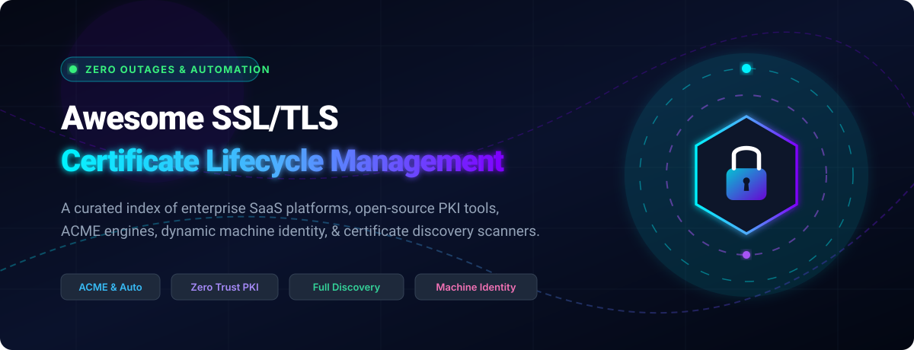

# 🛡️ Awesome SSL Certificate Lifecycle Management (CLM)

<p align="center">
  <a href="https://github.com/ishandutta2007/Awesome-Awesome-Awesome"></a>
  <a href="https://discord.gg/jc4xtF58Ve"></a>
  <a href="https://github.com/ishandutta2007/Awesome-SSL-Certificate-Lifecycle-Management/stargazers"></a>
  <a href="https://github.com/ishandutta2007/Awesome-SSL-Certificate-Lifecycle-Management/network/members"></a>
  <a href="https://github.com/ishandutta2007/Awesome-SSL-Certificate-Lifecycle-Management/blob/main/LICENSE"></a>
  <a href="https://github.com/ishandutta2007/Awesome-SSL-Certificate-Lifecycle-Management/pulls"></a>
  <a href="https://github.com/ishandutta2007"></a>
</p>

<p align="center">
  
</p>

---

## 📑 Overview & Ecosystem Landscape

Welcome to the **Awesome SSL/TLS Certificate Lifecycle Management (CLM)** repository — a comprehensive, SEO-optimized, community-curated index of the top enterprise **SaaS platforms**, **open-source PKI software**, **ACME automation engines**, **machine identity management systems**, and **continuous certificate discovery scanners**.

As certificate lifetimes shrink (toward 45-day validity windows) and zero-trust architectures mandate continuous encryption across multi-cloud environments, automated certificate lifecycle management has transitioned from an operational convenience to a mission-critical cybersecurity requirement.

---

## 📌 Table of Contents

- [☁️ SaaS / Hosted Platforms](#-saas--hosted-platforms)
- [💻 Open-Source GitHub Projects](#-open-source-github-projects)
- [🏗️ Reference Architecture & Frameworks](#️-reference-architecture--frameworks)
- [📈 Star History](#-star-history)
- [🤝 How to Contribute](#-how-to-contribute)
- [⚠️ Disclaimer](#️-disclaimer)

---

## ☁️ SaaS / Hosted Platforms

> **📊 Market Size & Industry Dynamics:** The global Certificate Lifecycle Management (CLM) software market is currently valued at approximately **$5.25 Billion** (2025/2026) and is projected to expand to **$11.05+ Billion by 2030** at a **15.6% CAGR**. The sector is actively transitioning from a historically fragmented ecosystem of manual tools into a **concentrated, consolidated market** led by major enterprise identity, digital trust, and PKI giants through aggressive M&A and platform convergence.

| Platform | Valuation / Revenue (Scale) | Description | Starting Pricing | Free Tier / Free Trial Limits |
| :--- | :--- | :--- | :--- | :--- |
| **[DigiCert Trust Lifecycle Manager](https://www.digicert.com/)** | **~$8.0B Valuation**<br>*(Majority owned by Clearlake Capital & Crosspoint; >$500M+ revenue)* | DigiCert’s unified CLM and digital trust platform — public and private certificate lifecycle with tight CA integration. | Essentials tier starts at ~$2,500/year (seat-based licensing across Essentials, Advanced, and Premium tiers) | 30-day free trial account available upon request (includes discovery & lifecycle evaluation) |
| **[Venafi (CyberArk Machine Identity)](https://www.venafi.com/)** | **$1.54B Acquisition**<br>*(Acquired by CyberArk for $1.54B; CyberArk acquired by Palo Alto Networks for $25B+)* | Leading machine identity and certificate management platform for large enterprises — broad integrations and policy-driven CLM. | Starts at ~$150,000/year for enterprise contract; private offers on AWS Marketplace | 30-day free trial for TLS Protect Cloud (includes full domain certificate discovery scan & visibility) |
| **[Keyfactor](https://www.keyfactor.com/)** | **~$1.3B Unicorn Valuation**<br>*(Backed by Summit Partners & Insight Partners; >$100M+ ARR)* | Enterprise certificate lifecycle and PKI platform (includes EJBCA) — strong AD CS integration, discovery, and full-stack machine identity. | Starts at ~$75,000/year for enterprise platform; cloud marketplace instances via AWS/Azure private offers | 30-day free trial on AWS/Azure Marketplace for EJBCA Enterprise Cloud; open-source EJBCA Community Edition free forever |
| **[Entrust PKI / Certificate Management](https://www.entrust.com/)** | **~$800M+ Revenue**<br>*(Privately held identity & cryptography multinational)* | Enterprise PKI and certificate services for identity and machine trust. | Core PKIaaS bundles start at £6,000/year (~$7,800/year); individual certificates from $24/cert/year | 60-day free trial for Managed PKI upon request; free discovery tools |
| **[Sectigo Certificate Manager](https://www.sectigo.com/)** | **~$250M - $300M Revenue**<br>*(Backed by GI Partners; major global commercial Certificate Authority)* | Certificate lifecycle management tied to a major public CA, with automation and CA-agnostic options. | SCM Pro starts at $10.75/month ($129/year) per domain; Wildcard tier at $48.25/month | 30-day free trial (includes discovery scan and up to 5 free 90-day DV certificates; no credit card required) |
| **[AppViewX](https://www.appviewx.com/)** | **~$100M+ Valuation**<br>*(Backed by Haveli Investments & Brighton Park Capital; ~$35M-$50M ARR)* | Certificate and crypto automation platform with strong network device support, workflows, and crypto-agility features. | Starts at ~$15,000/year for AVX ONE CLM base deployment / AWS Marketplace private offers | 30-day free trial on AppViewX Cloud & AWS Marketplace; includes unlimited free public SSL discovery scan |
| **[Smallstep (Certificate Manager)](https://smallstep.com/)** | **~$40M - $60M Valuation**<br>*(Backed by CRV & Boldstart Ventures; $42M total funding)* | Modern certificate automation and private CA platform (commercial offerings built on open step-ca). | Hosted plans start at $3.00/host/month; custom enterprise bundles for advanced scale | Free forever tier for homelabs and small teams (free SaaS Certificate Manager with `step-ca` integration) or 14-day enterprise trial |
| **[ZeroSSL](https://zerossl.com/)** | **~$5M - $10M ARR**<br>*(Part of apilayer / Idera, Inc. portfolio)* | Certificate authority and management tools with ACME support and free/paid certificate options. | Basic plan starts at $9.99/month ($119.88/year); Premium at $52.99/month | Free forever plan (3 90-day certificates via UI; unlimited 90-day certificates via ACME API) |
| **[KeyTalk](https://www.keytalk.com/)** | **~$3M - $5M ARR**<br>*(Privately held Dutch enterprise PKI & CKMS provider)* | Certificate and key management solutions focused on automated delivery and lifecycle. | CKMS platform licenses start at ~€2,500/year (~$2,700/year) based on managed seats/endpoints | 30-day Proof of Concept (PoC) / evaluation trial license with full technical consultation |
| **[Certify The Web](https://certifytheweb.com/)** | **~$1M - $2M ARR**<br>*(Bootstrapped profitable micro-SaaS)* | Windows-oriented certificate management and ACME automation for IIS and related workloads. | $59.00/year per server license (or $4.99/server/month on Microsoft Azure Marketplace) | Free forever Community Edition (manages up to 5 certificates per server install; community support) |

---

## 💻 Open-Source GitHub Projects

Curated list of leading open-source repositories for automated issuance, private certificate authorities, ACME protocol clients, secrets management, and cryptographic primitives — sorted by GitHub Stars in descending order.

- **[Caddy](https://github.com/caddyserver/caddy)** [](https://github.com/caddyserver/caddy/stargazers)  
  Fast, multi-platform web server with automatic HTTPS by default using ACME (Let's Encrypt / ZeroSSL) with fully automated certificate renewal, OCSP stapling, and multi-issuer failover.

- **[Traefik](https://github.com/traefik/traefik)** [](https://github.com/traefik/traefik/stargazers)  
  Cloud-native HTTP reverse proxy and load balancer with automatic Let's Encrypt / ACME TLS certificate provisioning, HTTP/3 support, and ingress orchestration.

- **[mkcert](https://github.com/FiloSottile/mkcert)** [](https://github.com/FiloSottile/mkcert/stargazers)  
  Zero-config tool for generating locally trusted SSL/TLS development certificates signed by an automatically created and installed local Root CA.

- **[acme.sh](https://github.com/acmesh-official/acme.sh)** [](https://github.com/acmesh-official/acme.sh/stargazers)  
  Pure Unix shell ACME client implementing full ACME v1 and v2 protocols with zero dependencies, supporting 150+ DNS API providers for automated DNS-01 challenge verification.

- **[Certbot](https://github.com/certbot/certbot)** [](https://github.com/certbot/certbot/stargazers)  
  EFF's official ACME client that automatically fetches and deploys free SSL/TLS certificates from Let's Encrypt for Apache, Nginx, and custom Linux servers.

- **[OpenSSL](https://github.com/openssl/openssl)** [](https://github.com/openssl/openssl/stargazers)  
  The foundational cryptography toolkit and library providing robust implementations of TLS/SSL protocols, X.509 certificate generation, key management, and PKI CLI operations.

- **[cert-manager](https://github.com/cert-manager/cert-manager)** [](https://github.com/cert-manager/cert-manager/stargazers)  
  Kubernetes-native certificate controller that automates the issuance and renewal of TLS certificates from ACME (Let’s Encrypt), HashiCorp Vault, Venafi, and internal CA issuers.

- **[Lego](https://github.com/go-acme/lego)** [](https://github.com/go-acme/lego/stargazers)  
  Pure Go ACME client library and CLI tool supporting Let's Encrypt and RFC 8555 ACME CAs with built-in support for dozens of DNS providers.

- **[CFSSL (Cloudflare PKI & TLS toolkit)](https://github.com/cloudflare/cfssl)** [](https://github.com/cloudflare/cfssl/stargazers)  
  Cloudflare’s open-source PKI and TLS Swiss Army knife for signing, verifying, and bundling TLS certificates, serving as an HTTP-based Certificate Authority.

- **[step-ca (Smallstep Certificates)](https://github.com/smallstep/certificates)** [](https://github.com/smallstep/certificates/stargazers)  
  Private Certificate Authority (CA) and ACME server for automated X.509 and SSH certificate issuance, zero-trust service-to-service mTLS, and internal infrastructure PKI.

- **[Lemur (Netflix)](https://github.com/Netflix/lemur)** [](https://github.com/Netflix/lemur/stargazers)  
  Netflix's certificate orchestration and lifecycle management platform for discovering, creating, and tracking SSL/TLS certificates across multi-cloud environments.

- **[SPIRE (SPIFFE Runtime Engine)](https://github.com/spiffe/spire)** [](https://github.com/spiffe/spire/stargazers)  
  Production-ready implementation of the SPIFFE APIs that performs node and workload attestation to securely issue short-lived cryptographic X.509 SVID machine identities.

- **[EJBCA Community](https://github.com/Keyfactor/ejbca-ce)** [](https://github.com/Keyfactor/ejbca-ce/stargazers)  
  Enterprise-grade, open-source Public Key Infrastructure (PKI) and Certificate Authority (CA) supporting multi-tier CAs, CRL/OCSP responders, EST, CMP, and ACME.

- **[trust-manager](https://github.com/cert-manager/trust-manager)** [](https://github.com/cert-manager/trust-manager/stargazers)  
  Operator for distributing and managing trusted Root CA certificate bundles across all namespaces in Kubernetes clusters seamlessly.

---

## 🏗️ Reference Architecture & Frameworks

Building a robust, modern, zero-outage certificate management pipeline generally involves pairing complementary open-source and commercial technologies:

```
┌────────────────────────────────────────────────────────────────────────┐
│               Enterprise Certificate Lifecycle Governance              │
│    (Discovery Scanners • Crypto-Agility • Expiration Alerting)        │
└───────────────────────────────────┬────────────────────────────────────┘
                                    │
       ┌────────────────────────────┴────────────────────────────┐
       ▼                                                         ▼
┌──────────────────────────────┐                         ┌───────────────┐
│     Public Trust (Web)       │                         │ Private /     │
│   Let's Encrypt / ZeroSSL    │                         │ Internal PKI  │
│   DigiCert / Sectigo         │                         │ step-ca /     │
└──────────────┬───────────────┘                         │ EJBCA / Vault │
               │                                         └───────┬───────┘
               ▼                                                 ▼
┌──────────────────────────────┐                         ┌───────────────┐
│   ACME Protocol Automation   │                         │  Workload &   │
│  (cert-manager, acme.sh,     │                         │  Node Trust   │
│   Certbot, Lego, Caddy)      │                         │  (SPIRE, mTLS)│
└──────────────────────────────┘                         └───────────────┘
```

1. **Edge & Ingress**: Use **Caddy**, **Traefik**, or **cert-manager** with ACME for automatic public TLS issuance and continuous renewal.
2. **Internal Workloads & Service Mesh**: Deploy **step-ca** or **SPIRE** for short-lived, automated mTLS certificates.
3. **Enterprise Core CA**: Run **EJBCA Community** or enterprise PKI (Keyfactor, DigiCert TLM, Venafi) for policy enforcement, AD CS replacement, and regulatory compliance.
4. **Secrets & Vault Engine**: Utilize HashiCorp Vault PKI engine or cloud HSMs for dynamic, ephemeral credential creation.

---

## 📈 Star History

[](https://star-history.dera.page/#ishandutta2007/Awesome-SSL-Certificate-Lifecycle-Management&type=date&legend=top-left)

---

## 🤝 How to Contribute

We welcome contributions to expand and refine this ecosystem directory!

1. 🍴 **Fork** the repository.
2. 🌿 **Create a Branch** (`git checkout -b add-clm-tool`).
3. 📝 **Add/Update Entry** in `README.md` (keep descriptions objective, link official docs, and follow standard markdown conventions).
4. 🚀 **Submit a Pull Request** with a concise explanation.

Explore more curated lists on [Awesome Awesome Awesome](https://github.com/ishandutta2007/Awesome-Awesome-Awesome).

---

## ⚠️ Disclaimer

- This list is **community-curated** for educational, architectural, and operational reference purposes.
- Always perform thorough validation and testing of renewal, rotation, and revocation procedures before deploying automated certificate tooling into production environments.
- Private CAs and root keys require strict hardware or KMS protections and operational auditing.

---

<p align="center">
  <b>Built with ❤️ for DevOps, Platform Engineers, SREs, and Security Architects striving for 100% TLS uptime.</b>
</p>
